<div align="center">

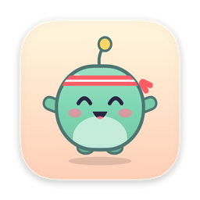

# StandUp Pal

**A tiny fitness pet in your Mac's menu bar that gets you out of your chair before every hour ends.**

[](#-install)
[](Package.swift)
[](Package.swift)
[](#-three-languages)
[](LICENSE)
[](https://ko-fi.com/deus42)

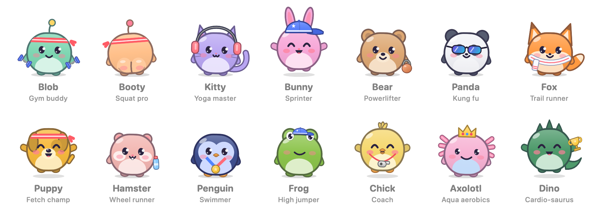

</div>

---

Sitting all day is rough on your back, your eyes and your mood, and most break timers just nag. StandUp Pal nudges you **five minutes before every working hour ends**, walks you through a **2–5 minute warm-up**, and turns every stretch into XP for a pet that levels up, unlocks fitness gear, and is genuinely delighted when you move.

It's a native macOS app: a few megabytes of Swift, no Electron, no accounts, no network.

<table>
  <tr>
    <td align="center" width="33%">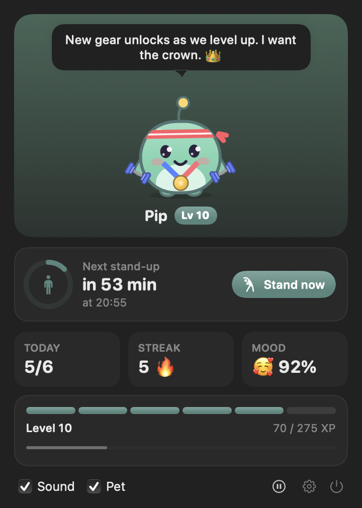<br><sub><b>Click the pet:</b> countdown, today's progress, streak, mood</sub></td>
    <td align="center" width="33%">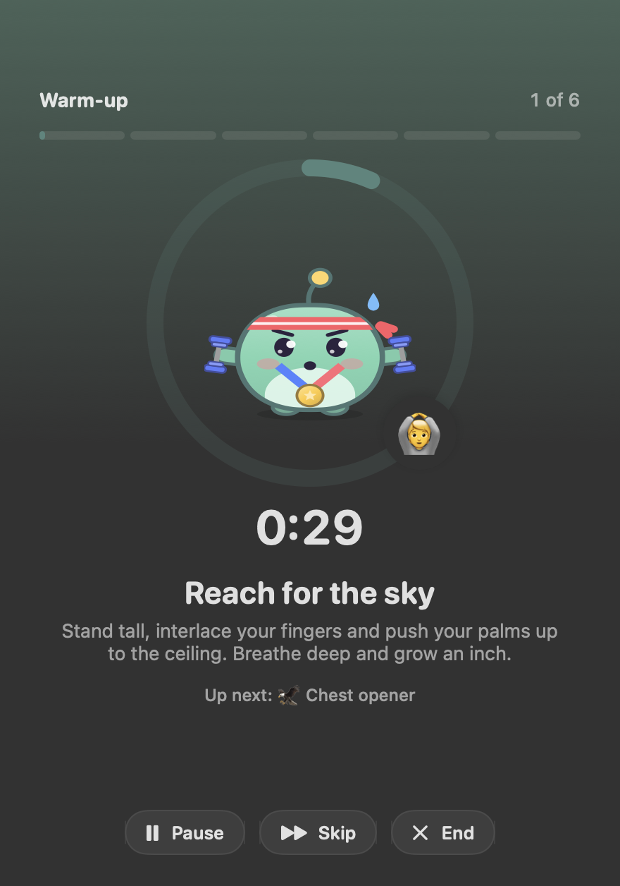<br><sub><b>Guided warm-ups</b> with a fresh mix every time</sub></td>
    <td align="center" width="33%">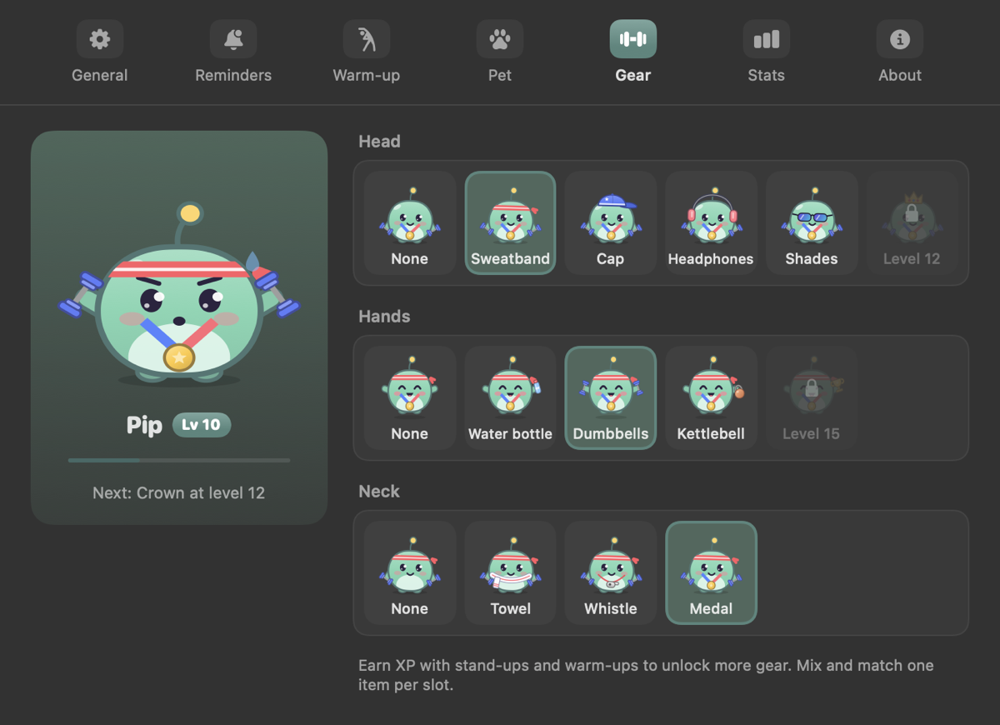<br><br>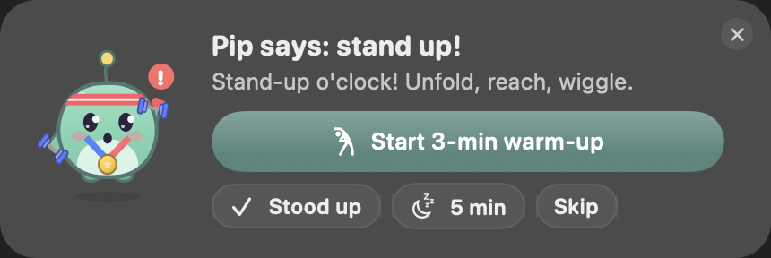<br><sub><b>Fitness gear</b> to unlock, and a reminder that never steals focus</sub></td>
  </tr>
</table>

## ✨ Features

### 🧍 Stand-up reminders that respect your flow
- Fires at **:55 of every working hour** by default (09:55 … 17:55 for a 9–18 day). Interval (30 min to 2 h), lead time, working hours, work days and a quiet lunch break are all yours to set.
- The reminder is a floating card in the top-right corner that **never steals keyboard focus**: *Start warm-up*, *Stood up*, *Snooze*, *Skip*.
- A gentle second nudge after 3 minutes; the card retires on its own after 20.

### 🤸 Guided warm-ups
- 2, 3 or 5 minutes: an energising opener, a shuffled middle, a calm closer (breathing or an eye break).
- 16 built-in desk-friendly exercises. Switch any of them off, or **add your own**.
- Countdown ring, "up next" preview, pause/skip/end, optional spoken exercise names, and confetti at the end.

### 💪 Your own exercise reminders
- Push-ups, water, a walk, anything: pick an emoji and a note, set times ("11:30 and 16:30") or an interval ("every 2 h, 10:00–18:00"), and the days.
- When one pops up: **Done**, **+1 hour**, **+2 hours** or **Skip**.

### 🐾 Fourteen fitness pets
Blob the gym buddy, Kitty the yoga master, Bear the powerlifter, Penguin the swimmer, Chick the coach, Axolotl on aqua aerobics, Dino the cardio-saurus… and **Booty**, the squat pro, who looks just like Blob until it turns round to wiggle its peachy behind. 🍑

- Seven animated moods: it dozes outside work hours, waves when it's time, sweats through warm-ups, celebrates your wins and sulks (a little) when you skip.
- **28 two-tone palettes** (body + belly) plus any custom colour. The whole app picks up your pet's colour.
- Don't want a pet? Untick **Pet** for a clean SF Symbol and the same reminders.

<details>
<summary><b>See every pet, mood and piece of gear</b></summary>
<br>
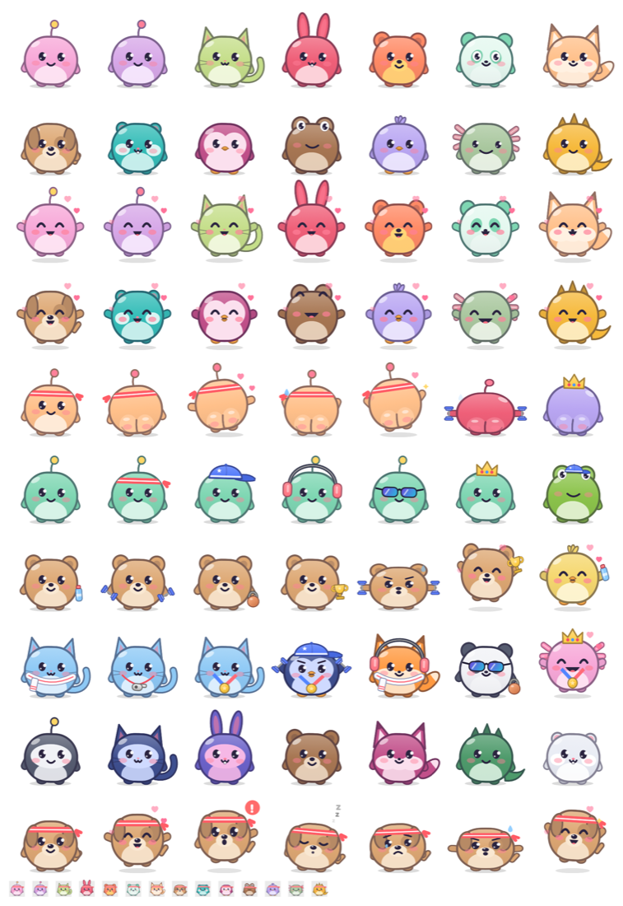
</details>

### 🏋️ Fitness gear
Stand-ups and warm-ups earn XP. Levels unlock gear, one item per slot, to mix and match:

| Slot | Gear (unlock level) |
| --- | --- |
| Head | Sweatband (from the start) · Cap (3) · Headphones (6) · Shades (9) · Crown (12) |
| Hands | Water bottle (2) · Dumbbells (5) · Kettlebell (8) · Trophy (15) |
| Neck | Towel (4) · Whistle (7) · Medal (10) |

Plus a daily goal, streaks (days off never break one), happiness and a 14-day chart.

### 🧠 Smart, not naggy
- **Already away?** No keyboard or mouse for 5+ minutes when a stand-up is due counts as done, and stays quiet.
- **On a call?** If your camera or microphone is in use by an app, reminders wait silently until the call ends. It only asks macOS whether a device is busy: nothing is recorded and no permissions are needed.
- **Sleep-safe:** reminders missed while the Mac slept are dropped, not dumped on you all at once.

### 🔔 Gentle sounds
Soft synthesized chimes (Soft chime, Marimba, Kalimba, Bubble pop, or the system Tink/Glass), a volume slider, and one **Sound** checkbox to turn them all off.

### 🌍 Three languages
English, **Українська** and **Русский**, switchable live from the right-click menu or Settings (or "Same as macOS"). Proper plural forms ("1 перерва, 3 перерви, 6 перерв"), and the Ukrainian and Russian texts avoid gendered verb forms, because neither your gender nor your pet's is known.

<p align="center">
  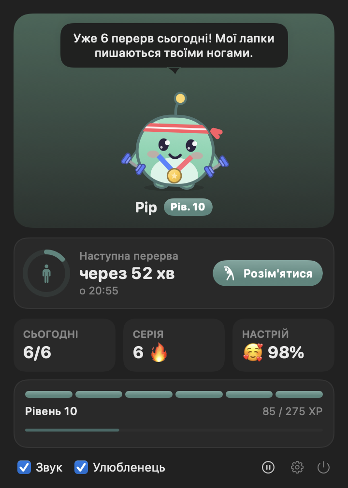&nbsp;&nbsp;
  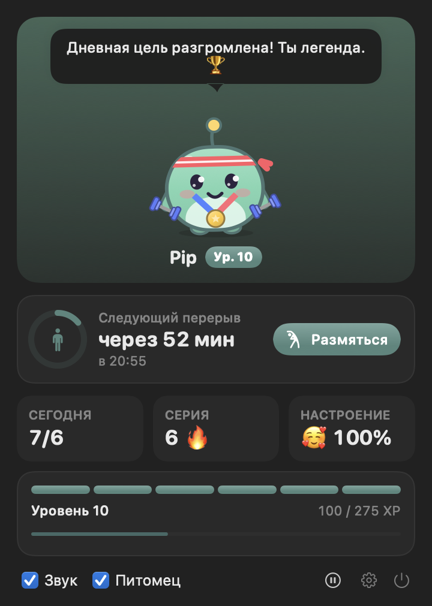
</p>

### 🔒 Private by design
Everything stays on your Mac: no accounts, no network, no analytics, no telemetry. State lives in `UserDefaults`.

## 📦 Install

Requires **macOS 14 Sonoma or later**. Runs natively on Apple silicon and Intel.

### Download

1. Grab **`StandUp-Pal-<version>.dmg`** from the [latest release](https://github.com/deus42/standup-pal/releases/latest) and open it. (Prefer a zip? It's there too.)
2. Drag **StandUp Pal** onto the **Applications** folder in the window that opens.
3. Open it. The app is free and open source but not notarized by Apple, so the first launch needs one extra step:
   - macOS will say it can't verify the app. Open **System Settings › Privacy & Security**, scroll down and click **Open Anyway**, or
   - run this once in Terminal:
     ```bash
     xattr -dr com.apple.quarantine "/Applications/StandUp Pal.app"
     ```
4. Look for the little pet in your menu bar. 🐾

### Build from source

You need a Swift toolchain. Full Xcode works; so do just the Command Line Tools (`xcode-select --install`).

```bash
git clone https://github.com/deus42/standup-pal.git
cd standup-pal
scripts/build-app.sh --install
```

This builds a release `.app`, renders its icon, signs it ad-hoc, copies it to `/Applications` (or `~/Applications` if that isn't writable) and launches it. Without `--install` the app lands in `build/StandUp Pal.app`. Add `--universal` for an Apple silicon + Intel build, and `--dmg` / `--zip` for a drag-to-Applications disk image or a zip, each with a SHA-256 checksum.

Turn on **Settings › General › Launch at login** to have it start with your Mac.

## 🕹️ Using it

- **Click** the pet in the menu bar: countdown, today's progress, upcoming extras, and the **Sound** / **Pet** checkboxes.
- **Right-click** it: start a warm-up, toggle Sound/Pet/countdown, pause (30 min, 1 h, 2 h, until tomorrow), language, Settings, Quit.
- **Settings** has seven tabs (General, Reminders, Warm-up, Pet, Gear, Stats, About). None of them scrolls: the window resizes to fit each tab.
- Tap your pet. It likes that.

<details>
<summary><b>Settings tour</b></summary>
<br>
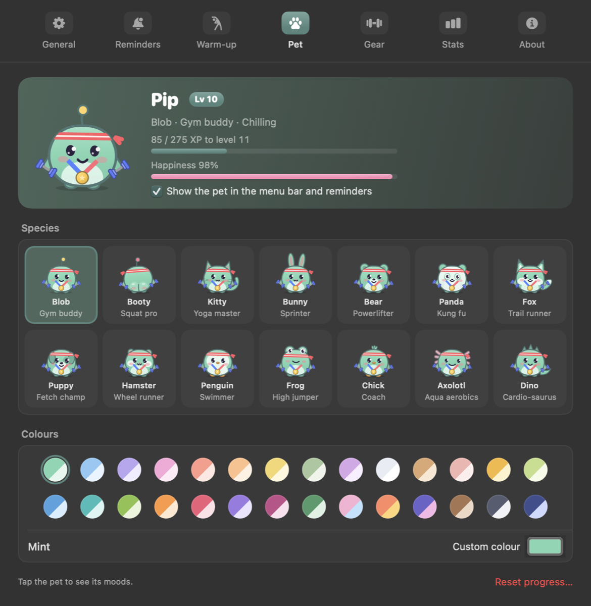<br><br>
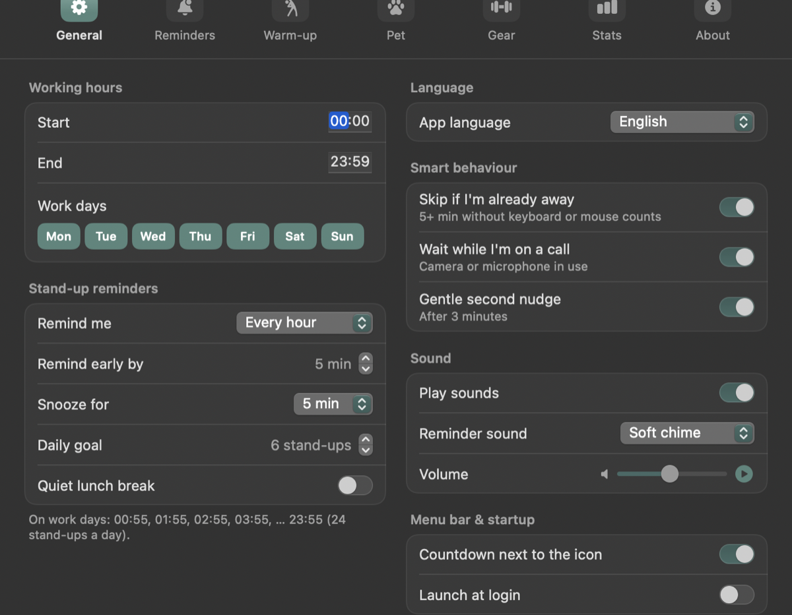<br><br>
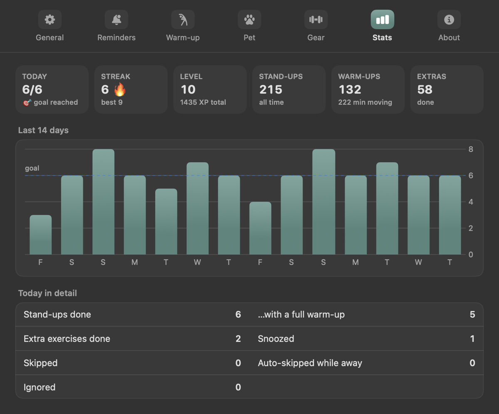<br><br>
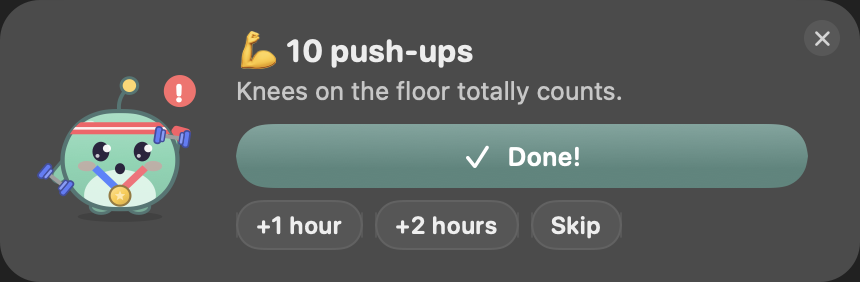
</details>

## 🛠️ How it's built

- **100% Swift**, SwiftPM only: no Xcode project, no third-party dependencies, **no asset files**. The pets, the app icon and every sound are drawn or synthesized in code.
- **AppKit** for the status item, the non-activating reminder panel and windows; **SwiftUI** for every view; **Swift Charts** for stats.
- A procedural **pet painter** (SwiftUI `Canvas`, 100×100 design space) renders the live pet, the menu bar icon and the app icon from one code path.
- The **scheduler** derives everything from the clock on each tick and stays idempotent, so sleep, wake and relaunch can't double-fire.
- **Presence** comes from `CGEventSource` idle time, Core Audio process input state and CoreMediaIO, none of which need permissions.
- **Localization** is `tr("English", "Українська", "Русский")` at the point of use, so a missing translation is a compile error rather than a surprise.

```
Sources/StandUpPal/
  App/        AppDelegate (status item, menus, windows), entry point, icon/art export
  Core/       AppStore (persistence), Scheduler, Presence, SoundPlayer (synth), PetTalk
  Model/      Settings (species, gear), reminders, exercises, progress
  Support/    L10n (tr, plurals), Clock (localized time formatting), RGB + palettes
  UI/         Popover, reminder card, warm-up, settings tabs, pet painter
```

## 🧪 Development

```bash
swift build          # debug build
scripts/test.sh      # 28 tests: scheduling, live ticks, flows, persistence, routines, languages, palettes, gear
```

Handy flags for the built binary:

| Flag | Does |
| --- | --- |
| `--demo-reminder` / `--demo-extra` | show a preview reminder card |
| `--demo-warmup` | start a warm-up |
| `--open-settings` / `--open-popover` | open those windows |
| `--snapshot <dir>` | render every window to PNGs, then quit (no screen-recording permission needed; uses its own state, never yours) |
| `--snapshot <dir> --all-languages --showcase` | the same in all three languages, with a lived-in demo pet |
| `--export-icon <png>` / `--export-lineup <png>` / `--export-gallery <png>` | render the app icon / the pet lineup / the full art sheet |

Toolchain note: in the macOS 27 SDK `@State` resolves to a macro whose plugin ships only with full Xcode, so views use `@ViewState` (a typealias to the same property wrapper) and build fine with just the Command Line Tools. `scripts/test.sh` similarly points the compiler at the Swift Testing macro plugin.

To start over: `defaults delete com.deus.standuppal`.

## 🤝 Contributing

Issues and pull requests are welcome: new species, gear, exercises, sounds, or another language. A few house rules keep the app what it is:

- No network access, analytics or bundled assets: draw it or synthesize it.
- Every user-facing string goes through `tr(en, uk, ru)` (or `Words` for counted nouns). Adding a language means adding a case to `Lang` and a parameter to `tr`, and the compiler will show you every string to translate.
- Settings tabs must fit without scrolling.
- Run `scripts/test.sh`, and check your UI with `--snapshot --all-languages`.

## ☕ Support

If StandUp Pal got you off your chair, you can buy me a coffee. It keeps the pets fed. 🐾

<a href="https://ko-fi.com/deus42"></a>

## 📄 License

[MIT](LICENSE) © 2026 Oleksii Gapchenko
